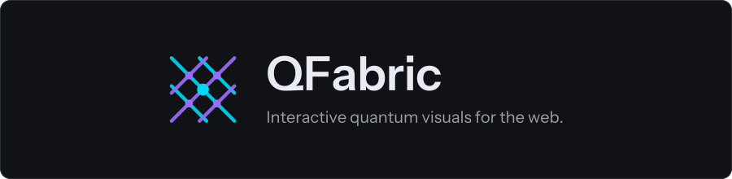
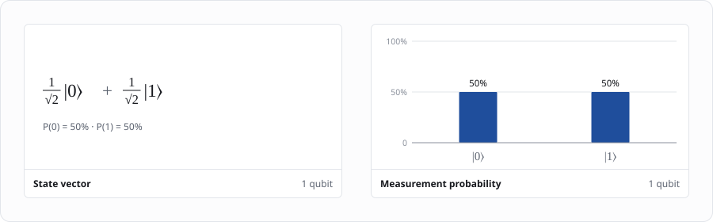

<p align="center">
  
</p>

<p align="center">
  <a href="https://github.com/maninresearch/qfabric/actions/workflows/ci.yml"></a>
  <a href="./LICENSE"></a>
  
  
</p>

---

**QFabric** is a set of framework-agnostic web components for showing quantum
states on the web, built on a small, tested quantum math engine. On top of the
components sits an authoring layer: write markdown with a few directive blocks
and get a lesson page with live quantum figures, with no JavaScript to write.

> The only bottleneck should be your understanding of the quantum concept, not the tooling.

> [!NOTE]
> QFabric is in early development (pre-1.0), so the API may still change. Two
> components ship today, `<qf-state-vector>` and `<qf-probability>`. See the
> [roadmap](#roadmap) for what's planned.

- **Web components.** Standard custom elements that work in any page or framework.
- **Markdown authoring.** Lesson writers use `:::state-vector` blocks, never CSS or JavaScript.
- **Tested math.** The state-vector engine is unit-tested against textbook results.
- **Accessible and themeable.** Screen-reader descriptions, light and dark themes, reduced-motion support.

## What it looks like

This is the whole source for an interactive lesson:

```markdown
# Superposition

A qubit doesn't have to be just |0⟩ or |1⟩. It can exist in a **superposition**
of both states at once.

:::row

:::state-vector
state: "|+⟩"
:::

:::probability
state: "|+⟩"
:::
```

`@qfabric/remark-plugin` turns each `:::block` into a `<qf-*>` web component and
`:::row` into a side-by-side layout. `@qfabric/astro` wires it into an Astro site.
The components render like this:

<p align="center">
  <picture>
    <source media="(prefers-color-scheme: dark)" srcset="./assets/example-preview-dark.svg" />
    
  </picture>
</p>

<p align="center"><sub>Generated from <code>@qfabric/core</code> with <code>pnpm gen:assets</code>. The amplitudes, probabilities and bar heights are the engine's real output for <code>|+⟩</code>.</sub></p>

## Usage

```bash
npm install @qfabric/core
```

For an Astro site, see [`@qfabric/astro`](./packages/astro).

### Components in any page

```js
import '@qfabric/core/state-vector';
import '@qfabric/core/probability';
```

```html
<qf-state-vector state="|+⟩"></qf-state-vector>
<qf-probability state="|+⟩"></qf-probability>
```

### The math engine on its own

```js
import { runCircuit, parseCircuit, measure } from '@qfabric/core/math';

const bell = runCircuit(2, parseCircuit(['H 0', 'CNOT 0 1']));
bell.probabilities();      // Float64Array [0.5, 0, 0, 0.5]
measure(bell).bitstring;   // "00" or "11", never "01" or "10"
```

## Run the example site

```bash
corepack enable
pnpm install
pnpm --filter @qfabric/examples dev      # live dev server
# or build it:
pnpm --filter @qfabric/examples build
```

Open the superposition lesson to see the components live. The example lives in
[`examples/`](./examples).

## Packages

| Package | Description |
| --- | --- |
| [`@qfabric/core`](./packages/core) | Web components (Lit 3), the quantum math engine, design tokens. |
| [`@qfabric/remark-plugin`](./packages/remark-plugin) | Markdown integration: turns `:::component` blocks into `<qf-*>` tags. |
| [`@qfabric/astro`](./packages/astro) | Astro integration: registers the plugin, loads tokens, self-hosted fonts and components. |

## Roadmap

Planned, roughly in order. None of this exists yet.

- **More components:** circuit diagrams (including an interactive builder), Bloch
  sphere, Q-sphere, phase disk, density matrix, gate matrix and measurement.
- **Linked components:** a circuit driving a Bloch sphere and probability chart on the
  same page.
- **Animated and interactive modes** for each component, with keyboard support.
- **Per-page loading** in `@qfabric/astro`, so a page only downloads the components it uses.
- **Script-tag builds** on a CDN, with Subresource Integrity hashes.
- **Build-time validation** of directive parameters, with clear error messages.
- **A documentation site** with a component reference and an authoring guide.
- **Later:** quantum physics and quantum machine learning component sets.

Ideas and feedback are welcome in [GitHub Discussions](https://github.com/maninresearch/qfabric/discussions)
or [issues](https://github.com/maninresearch/qfabric/issues).

## Development

Requires Node 22+ and pnpm 10+ (`corepack enable` picks the right version).

```bash
pnpm install
pnpm build       # build all packages
pnpm test        # unit and component tests
pnpm verify      # everything CI runs: lint, build, typecheck, coverage, package checks, smoke test
```

See [CONTRIBUTING.md](./CONTRIBUTING.md) for the full workflow.

## Contributing

See [CONTRIBUTING.md](./CONTRIBUTING.md). Please also read the
[Code of Conduct](./CODE_OF_CONDUCT.md) and the [security policy](./SECURITY.md).
Each package keeps its release history in its own `CHANGELOG.md`.

## Citing QFabric

If you use QFabric in academic work, please cite it. See [CITATION.cff](./CITATION.cff).

## License

[Apache-2.0](./LICENSE) © The QFabric Authors
